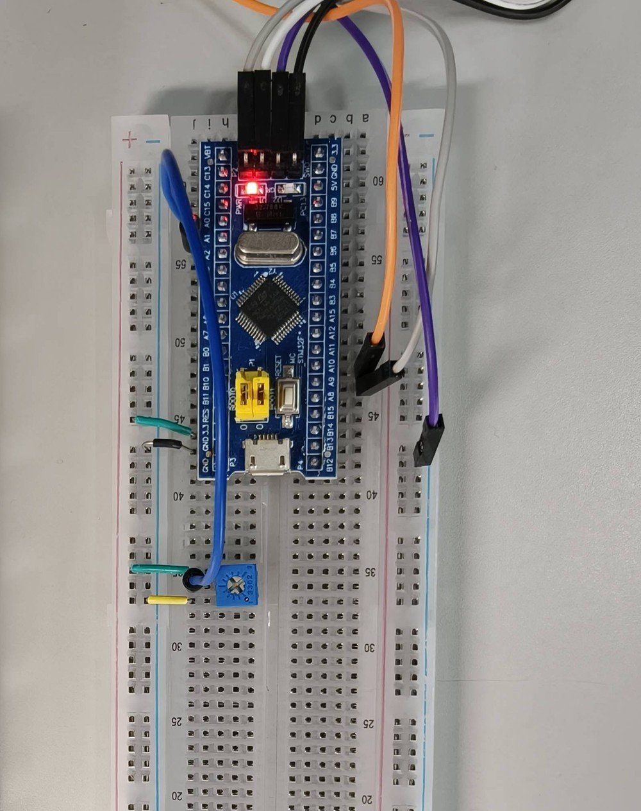

# STM32 单通道模拟量采集与故障监测终端

> **版本 v5.2.0**　构建 `Code=22468 / RO 1076 / RW 148 / ZI 4972`（与 8B-2 长跑实测固件一致）；交付包 `单通道模拟量采集与故障监测终端_v5.2.0.zip`

STM32F103C8T6 + HAL + Keil MDK。100Hz 定时器触发 ADC+DMA 采样 → 移动平均 → 三级告警状态机  
→ 故障诊断（信号卡死，默认关闭）→ 二进制帧协议经 DMA 上报 → Python 上位机实时双曲线 /  
在线改阈值 / CSV 导出 / 异常统计 / 故障快照对齐。

> **验证状态（务必先看）**　完整分级见 `docs/TEST_INVENTORY.md`，风险清单见同文件 §5
>
> - 固件：✅ **已实际编译通过**，`0 Error / 0 Warning`（Release `Code=22468 / RO 1076 / RW 148 / ZI 4972`，Flash 35.9% / RAM 25.0%）
> - PC 层：✅ 上位机 **72 项**单测 + 固件 C **1041 断言**，全绿（`host/tests/`、`fw_tests/`）
> - 上位机界面（演示源）：✅ 离屏运行 4 秒通过（约 400 点、整帧丢失 0、顶部为「演示模式」、事件表符合 50 mV 滞回），`docs/gui_demo.png`
> - 上位机界面（**真机串口**）：✅ **2026-11-02** 在 COM5 实测 16 s / 1597 点 / 0 丢点 / 0 整帧丢失，`docs/gui_real_serial.png`（端口号会变，见 §5.1）；**2026-11-05** 又用 **GUI 控件自动化 + 人手拧电位器 + 真机**跑完 8D 的 **D-1~D-12**（`docs/STAGE8D_EVIDENCE.md`，风险 R21）
> - 上板（基础链路）：✅ 10 分钟连续采集 60117 帧 / **100.01 Hz**，drops 0、整帧丢失 0、解析错误 0（§8）
> - 上板（零点 / 满量程）：✅ **+1.75 mV**（≈2.2 LSB）／**3299.87 mV**（4094.8 LSB），跨度误差 −0.057%（§9）
> - 上板（串口 HT）：✅ 长命令回显 69 B、`rxf` 增量 0；**反向对照**去掉早退后 `rxf` +10、回显 84 B，证明测试有判别力（§9.5）
> - **Stage 1** ADC 故障恢复：✅ 20 次注入 / 17 次恢复 / 丢样 0 / 恢复 2.1–4.9 ms（**注入的是错误标志，不是真实 DMA 电气故障**，§12）
> - **Stage 2** ADC 精度与线性：✅ 0–3300 mV **16/16 段**单调、群延迟 **40 ms**、3503 个帧间隔全 10 ms（§13）
> - **Stage 3** UART/DMA 异常：已跑 9 个用例 —— CRC、非法 LEN、长帧、TX 灌满、真实 FE 风暴均通过；**半截帧发现连锁丢 2 帧的缺陷**，已由加固 A 消除；ORE 注入 `saw_ore=1`（§14）
> - **Stage 3 加固 A/B**：✅ 半帧连锁已消除（3/3）、接收停摆 **152 ms** 自动救回（§14.1）
> - **Stage 4** 固件 C 单元测试：✅ 起步 **167 断言 0 失败**（GCC 编译**仓库里的真实源码**，不是重写，§15）
> - **Stage 6 第 1 项** 1 小时连续运行：✅ **3600 s / 360047 帧 / 100.010 Hz**，drops·丢帧·错误·复位·重连全 0，H1–H12 **12/12 PASS**（§17，记录 `docs/SOAK_60MIN_RECORD.md`）
> - **Stage 7** 多类型故障诊断设计审查：✅ 只出设计、**未改固件**（`docs/STAGE7_FAULT_DIAG_DESIGN.md`）
> - **Stage 7B** 信号卡死诊断模块：✅ `app_diag.c` + **121 条**单测（合计 288）；上板**只验了"默认关闭态 10 分钟长跑"**，触发/恢复当时无使能手段，后由 7C 的 `SET_DIAG` 补验（`docs/STAGE7B_*.md`）
> - **Stage 7C** 故障协议上报 + 上位机：✅ 板级实测——使能后 **3.02 s** 确认（`span=9 mV`）、人手拧动 `span=187 mV` **恢复**、停手后再次确认；非法参数被拒、关闭诊断不伪造恢复（`docs/STAGE7C_FAULT_PROTOCOL.md`）
> - **Stage 7C-2** `GET_DIAG` 状态快照 + TX 提交失败恢复：✅ 板级实测——**ACK 先于快照**（seq 46→47）、无故障/有故障快照字段正确、断线期间发生的恢复由重连快照给出真相、连续轮询抓到 **57 帧 `active=0`**；全程 915 帧 SEQ 异常 0（`docs/STAGE7C2_FINAL.md`）
> - **Stage 8B** 1h 对照与 8h 长跑：✅ 同构建 `Code=22468` 完成 **Y2（诊断关 1h，360051 帧）PASS**、**X2（诊断开 1h，360050 帧 / 100.014 Hz）PASS**、**8B-2（诊断关 8 小时 / 480 min，2880109 帧 / 约 100.014 Hz；含一次 NTP 台阶，表观 100.0038 Hz）H1–H12 12/12 PASS**，drops·丢帧·解析错·复位·重连全 0（`docs/STAGE8B_REPORT.md`、`docs/SOAK_480MIN_RECORD.md`；含同构建早期两轮 1h FAIL 的六轮成组记录见 `TEST_INVENTORY` R3）
> - 仍未测：**诊断开启（`en=1`）8 小时长跑**、**绝对电压精度（等万用表）**、**真实 HAL 重挂失败**、告警滞回手感、INL/DNL、**TX 环真实满载后的重试**、**真实传感器诊断** —— 见 §7 与 `TEST_INVENTORY` §5（R1–R21）；**后续验证计划见 `docs/STAGE8_PLAN.md`**

---

## 1. 与 V1 的差别

| 方面     | V1（DataTerm）                             | V5（本项目）                                 |
| ------ | ---------------------------------------- | --------------------------------------- |
| ADC 采样 | 轮询 `Start/Poll/GetValue/Stop`，CPU 参与每次转换 | **TIM3 TRGO 触发 → ADC → DMA 循环**，CPU 不参与 |
| 串口发送   | `HAL_UART_Transmit` 阻塞，一帧 5.2ms          | **DMA + 环形发送队列**，主循环零等待                 |
| 串口接收   | 逐字节中断 + 环形缓冲                             | **DMA + 空闲中断（IDLE）**，一次拿一批              |
| 上报协议   | ASCII 行                                  | **二进制帧**（帧头 + 类型 + 长度 + 序号 + CRC16）     |
| 上报速率   | 10Hz                                     | **100Hz**                               |
| 丢点     | 布尔标志，不可观测                                | **环形缓冲溢出计数**，上位机可见                      |
| 告警状态机  | 允许跨级跳转                                   | **只允许相邻跳转**，路径可追溯                       |
| 异常统计   | ADC/命令两类                                 | ADC / UART（再分 ORE·FE·NE·PE）/ 接收重挂 / 帧 / 解析超时 / 发送丢弃 |
| 上位机    | 无                                        | 双曲线、阈值下发、统计面板、CSV、事件表                   |

---

## 2. 目录结构

```
单通道模拟量采集与故障监测终端/
├── Core/                    ← 外设层（CubeMX 风格，初始化是手写的）
│   ├── Src/main.c                启动顺序、时钟 72MHz
│   │     adc.c                   ADC1 + T3_TRGO 触发；ADC1_RecoverInit() 故障复位
│   │     tim.c                   TIM2(1ms 节拍) / TIM3(100Hz 触发)
│   │     usart.c                 DMA 收发 + IDLE 接收 + RX 重挂守护
│   │     dma.c                   DMA1 三通道
│   │     gpio.c                  LED / 按键 EXTI
│   │     stm32f1xx_hal_msp.c     时钟、GPIO、DMA、NVIC 绑定
│   │     stm32f1xx_it.c          中断入口，只做转发
│   └── Inc/
├── App/                     ← 应用层（业务逻辑）
│   ├── Src/app_task.c            调度、采样流水线、组帧、LED 指示
│   │     app_measure.c           ADC+DMA 采样隔离层（唯一按设计直接碰 ADC HAL 的模块）
│   │     app_filter.c            移动平均 + 可选限幅
│   │     app_alarm.c             三级状态机
│   │     app_diag.c              故障诊断：信号卡死（1 s 分块极值，默认关闭）
│   │     app_fault.c             诊断结论 → FAULT 帧：active/reported 状态差驱动 + 快照载荷
│   │     app_proto.c             帧编解码 + CRC16
│   │     app_tx.c                发送环形队列（整帧原子）
│   │     app_cmd.c               双通道命令 + 半截帧超时复位
│   └── Inc/app_config.h          所有可调参数集中在此
├── Drivers/                 ← ST HAL 库 + CMSIS（含 Legacy 与 LL 头文件）
├── MDK-ARM/DataAcq.uvprojx  ← 双击打开
├── host/                    ← PC 上位机
│   ├── protocol.py               帧编解码（与固件一一对应，含 FAULT 快照）
│   ├── link.py                   串口读线程
│   ├── main.py                   PySide6 界面
│   ├── tests/                    72 项单测 + 界面冒烟
│   └── tools/                    抓帧 / 长跑 / 标定 / 线性扫掠 / HT / 异常注入 / 诊断盯帧
├── fw_tests/                ← 固件 C 模块单测（GCC 编译仓库里的真实源码，1041 断言）
└── docs/
    ├── PROTOCOL.md             协议逐字段说明（含 §4.8.1 上报语义、§4.10 GET_DIAG）
    ├── CUBEMX_CONFIG.md        CubeMX 配置对照表（本项目无 .ioc，原因见文内）
    ├── TEST_REPORT.md          编译与测试总账（§1–§20，按时间累积）
    ├── TEST_INVENTORY.md       证据分级清单（PC / 真板 / 注入）+ 风险 R1–R21 ← **先看这个**
    ├── AUDIT_20261103.md       文档一致性核对 + App/HAL 分层边界复核
    ├── CALIB_ABSOLUTE.md       绝对电压精度测试步骤（待万用表，未执行）
    ├── SOAK_PLAN.md            1 h / 8 h 长跑记录表 + H1–H12 门槛 + 电源设置
    ├── SOAK_60MIN_RECORD.md    1 小时长跑实测记录（脚本生成，非手填）
    ├── SOAK_480MIN_RECORD.md   **8 小时（480 min，诊断关）长跑实测记录（2880109 帧全 PASS）**
    ├── HW_VERIFY_NEXT.md       早期硬件验证清单（已被 STAGE8_PLAN.md 取代，仅留存历史）
    ├── STAGE7_FAULT_DIAG_DESIGN.md   多类型故障诊断设计审查（未改固件）
    ├── STAGE7B_STUCK_DIAG.md         卡死诊断模块 + 121 条单测
    ├── STAGE7C_FAULT_PROTOCOL.md     0x86/0x15 协议 + 上位机集成 + 板级实测
    ├── STAGE7C_PROTOCOL_AUDIT.md     8 条协议约束逐条核对
    ├── STAGE7C_GET_DIAG_DESIGN.md    GET_DIAG 设计（含状态机推演）
    ├── STAGE7C2_GET_DIAG.md          快照 + TX 失败恢复 实现报告
    ├── STAGE7C2_FINAL.md             7C-2 最终验收报告（四层证据分级）
    ├── STAGE8_PLAN.md                **Stage 8 收尾验证计划（R15/R16/R20/R21/R2）**
    ├── STAGE8B_REPORT.md             **Stage 8B 1h（Y2/X2）与 8h（8B-2）长跑报告 + 8B-2 一次 NTP 校时计数台阶分析**
    │                                 （该分析**只解释 8B-2 的台阶**，**不解释** 11-04 早期两轮丢帧；后者原因仍未定论）
    ├── STAGE8D_EVIDENCE.md           **Stage 8D / R21：GUI 按钮连真板证据（D-1~D-12 + P-1~P-8；5 张可用 GUI 截图，D-9/D-4/D-10/D-12 以日志为证）**
    ├── stage8d/                      8D 原始证据：`STAGE8D_LOG.txt`（含 GUI 文本通道全程日志）+ 5 张裁剪后的 GUI 截图 + 归档脚本 `run_8d.py`（脱敏）
    └── STAGE1–4 阶段报告与原始日志（STAGE1_ADC_RECOVERY / STAGE2_ADC_LINEARITY /
        STAGE3_UART_DMA / STAGE3_GUARD / STAGE4_C_UNIT_TESTS + *_RAW.txt）
```

> **关于分层**：这个工程不是严格分层的。`Core/` 的中断回调直接调用 `App/` 的函数，
> `App/` 里也有 3 个文件 4 处直接调 HAL（`app_measure.c` 属设计允许，`app_tx.c`、`app_task.c` 属越层）。
> 具体是哪几处、为什么这样、要不要收口，见 `docs/AUDIT_20261103.md` §2。**别信旧版"应用层不调 HAL"的说法。**

---

## 3. 编译与下载

**Keil 打开**：双击 `MDK-ARM/DataAcq.uvprojx`

**命令行编译**：

```bat
cd MDK-ARM
D:\K5\UV4\UV4.exe -b DataAcq.uvprojx -j0 -o build.log
```

期望输出：

```
"DataAcq\DataAcq.axf" - 0 Error(s), 0 Warning(s).
```

**下载配置**（一次性）：  
`Project → Options for Target` → `Debug` 页选 **ST-Link Debugger** → `Settings` → `Port = SW`  
→ `Utilities` 页勾 `Use Target Driver for Flash Programming` → `Settings` → 勾 **Reset and Run**

---

## 4. 接线

实物接线（本机实拍，2026-11-02 状态）：



> 照片只说明"实际长什么样"；**电气连接以下表为准** —— 照片里看不清每一根的落点，
> 尤其串口那两根是交叉的，插反了不会烧，但一个字都收不到。

| STM32          | 接到                    | 说明                              |
| -------------- | --------------------- | ------------------------------- |
| PA1 (ADC1_IN1) | 电位器中间抽头               | **只能 0~3.3V**，禁止负压与 5V          |
| PA9            | USB-TTL **RXD**       | 交叉接                             |
| PA10           | USB-TTL **TXD**       | 交叉接                             |
| GND            | USB-TTL GND           | **必须共地**                        |
| PA0            | 按键 → GND              | 内部上拉，下降沿                        |
| PC13           | 板载 LED                | NORMAL 灭 / WARN 2Hz 闪 / CRIT 常亮 |
| 尾排 4 针 SWD | ST-Link 3V3 / SWDIO / SWCLK / GND | 按丝印接，**不在两侧排针**；3.3V 与 USB 只接一路 |

⚠️ 电气红线：PA1 输入超 3.3V 会通过保护二极管灌电流，可能永久损坏 ADC。

---

## 5. 运行上位机

```bat
cd host
pip install -r requirements.txt

python main.py            :: 真实串口
python main.py --demo     :: 无硬件演示（内置 100Hz 信号源，走同一套解析路径）
```

界面功能：

- 串口选择 / 刷新 / 连接断开
- 原始值（灰）与滤波值（蓝）双曲线，叠加 WARN/CRIT 阈值虚线
- 当前级别色块（绿 / 琥珀 / 红）
- 运行时间、采样数、丢点、异常、状态切换、**序号缺口**、**整帧丢失**
- 在线改阈值并下发（带与固件一致的合法性校验）
- 读取统计 / 清零 / LED 开关
- CSV 记录（`pc_time, t_ms, raw_mv, filt_mv, level`）
- 告警事件表 + 文本通道日志
- **故障诊断面板**：使能/关闭诊断（`SET_DIAG`）、"查询故障状态"按钮（`GET_DIAG`）、
  当前故障与最近事件两行显示；**连接/重连成功后自动查一次**，用快照里的 `active` 覆盖本地状态

**不在界面里做的事**：断开后不自动重连（当前版本是手动点"连接"），  
避免串口被反复打开关闭导致驱动异常。这是有意的行为，不是缺陷。

### 5.1 串口号不是固定标识（文档里 COM5 / COM6 混用的原因）

本机这块 CH340 **没有 USB 序列号**（`hwid` 里 `SER=` 为空），Windows 是按
"插在哪个 USB 口 + 枚举顺序"分配 COM 号的，所以同一块板会时而 `COM5`、时而 `COM6`，
**烧录后重新枚举也会换号**。文档里出现两个号不是记录矛盾，是不同时间的快照：

| 时间 | 测试 | 端口 |
|---|---|---|
| 2026-11-02 10:22–11:05 | 10 分钟连续采集、零点/满量程、GUI 真机 16 s | **COM5** |
| 2026-11-02 23:46 | Stage 1 ADC 故障恢复 | **COM5** |
| 2026-11-03 08:48 起 | Stage 2 / Stage 3、1 小时长跑、7C 板级 | **COM6** |
| 2026-11-03 23:1x | 7C-2（`GET_DIAG` 快照），烧录后重枚举 | **COM5** |
| 2026-11-04 11:24–16:14 | Stage 8B 早期两轮 1h（Hub 1-2.2，均 FAIL） | **COM5 / COM4** |
| 2026-11-04 18:14 – 11-05 07:28 | Stage 8B（Y2 1h / X2 诊断开 1h / 8B-2 诊断关 8h，1-2.1.3，全 PASS） | **COM5** |

复跑时**先列端口，再照抄命令**，不要直接复制文档里的 COM 号：

```bat
python -c "import serial.tools.list_ports as lp; print([p.device for p in lp.comports()])"
```

> 顺带说明：`host/tools/` 下的脚本都支持"不传端口就自动取第一个"，就是这个原因。

---

## 6. 关键设计说明（面试会问）

**为什么用两个定时器**  
F1 的 ADC 外部触发只能用固定的几个源（`T1_CC1` / `T2_CC2` / `T3_TRGO` / `T4_CC4` / `EXT_IT11`），  
没有"通用 TRGO 输入"。若让 TIM2 的 CC2 触发，1ms 节拍与 10ms 采样会互相牵制。  
所以 TIM2 专职 1ms 时基，TIM3 专职 100Hz 触发。

**为什么 ADC DMA 缓冲用 uint16_t 数组却强转 uint32_t***  
F1 的 `HAL_ADC_Start_DMA()` 原型是 `uint32_t*`，但 DMA 实际按**半字**搬运。  
声明成 `uint32_t[]` 会让两个样本挤进同一个元素，索引全错。这是 F1 上很常见的坑。

**为什么发送必须走 DMA**  
16B 帧 @115200 = 1.39ms。阻塞发送在 10ms 采样周期里占 13.9%，  
会造成采样时刻抖动；DMA 后台搬运时主循环耗时只有一次 memcpy。

**为什么状态机不允许跨级**  
"正常→预警→确诊"是业务语义，每级都有独立进入条件，故障升级路径可追溯。  
代价是电压从 0 跳到 3200mV 需要 2 轮确认（60ms），对电压监测可接受。

**为什么 SEQ 和 CRC 都要**  
CRC 只能发现内容被改坏，发现不了整帧丢失；SEQ 不连续才能暴露丢帧。

---

## 7. 验证状态（诚实版）

| 内容                   | 状态                                                 |
| -------------------- | -------------------------------------------------- |
| 固件编译                 | ✅ 已实际编译通过（`Code=22468 / RO 1076 / RW 148 / ZI 4972`，0 Error / 0 Warning） |
| 协议层编解码（Python）       | ✅ **72 项**单测（CRC 标准向量、分包、连续 0xAA 容错、坏 CRC、超长 LEN、文本混流、阈值防溢出、端到端回放、FAULT 快照、跨语言契约向量、文档↔固件↔上位机三方一致） |
| 固件 C 模块（GCC，真实源码）  | ✅ **1041 断言 / 0 失败**：`app_proto` / `app_alarm` / `app_filter` / `app_diag` / `app_fault` / `app_cmd`（Stage 4 + 7B + 7C + 7C-2） |
| 固件与上位机协议一致性          | ✅ 已真实联调（10 分钟、60 万+ 字节、0 解析错误） |
| 上位机界面（演示源）      | ✅ 已离屏实际运行并断言（4 秒约 400 点、整帧丢失 0、解析错误 0、清零同步验证、顶部为「演示模式」）；另注入一次序号跳变验证检测确实生效 |
| 上位机界面（真机串口）    | ✅ 已实测（2026-11-02，`gui_snapshot.py COM5`）：连真板 16 s / **1597 点 / 丢点 0 / 整帧丢失 0**，截图 `docs/gui_real_serial.png`（端口号不固定，见 §5.1） |
| 采样率是否 100Hz | ✅ 已实测 **100.01 Hz**（60117 帧 / 601.1 s，见 TEST_REPORT §8） |
| DMA 收发是否丢数据 | ✅ 已实测 10 分钟 **drops 0 / 序号缺口 0 / 整帧丢失 0** |
| ADC 零点 / 满量程            | ✅ 已实测：零点 +1.75 mV（2.2 LSB）、满量程 3299.87 mV（4094.8 LSB，两次复测一致），跨度误差 −0.057%（§9） |
| ADC 中间量程线性             | ✅ 已实测：0–3300 mV **16/16 段**单调、无死区，步长中位 1 mV（Stage 2） |
| 滤波群延迟                | ✅ 已实测 **40 ms**（4 点，斜坡互相关；理论 35 ms） |
| 长命令 HT 重复交付           | ✅ 已实测 + 反向对照：修复版 rxf +0 / 回显 69 B；去掉早退后 rxf +10 / 回显 84 B |
| ADC 故障恢复（注入错误标志）     | ✅ Stage 1：20 次注入 / 17 次恢复 / 丢样 0 / 恢复 2.1–4.9 ms / 限速 997 ms（**注入的是标志，非真实电气故障**） |
| UART 异常（CRC/LEN/半帧/长帧/TX 满/FE 风暴） | ✅ Stage 3：9 项全部有结论；半截帧连锁已由加固 A 消除（3/3） |
| ORE 溢出                  | ✅ 实测 `saw_ore=1` 且链路不停摆；⚠ 但 ORE 被 DMA 顺带清掉、**错误中断未执行** |
| 接收停摆自动恢复              | ✅ Stage 3 加固 B：`rxstop` 后 **152 ms** 救回、3 分钟 9 次全成功 |
| 告警滞回手感               | △ C 单测覆盖了边界（2350/2349、2950/2949）；**上板在阈值附近缓慢往返未做** |
| 真实 HAL 重挂失败（`start_rx` 返回 BUSY） | ❌ **NOT TESTED**（风险 R1）                        |
| 绝对电压精度               | ❌ **NOT TESTED**，等万用表测 VDDA（风险 R2）           |
| INL / DNL             | ❌ 无法测（固件不上报原始码）                             |
| 1 小时连续运行               | ✅ 已实测：无诊断版 360047 帧 PASS（§17）；`Code=22468` **Y2（诊断关 1h，360051 帧）PASS**、**X2（诊断开 1h，360050 帧）PASS**（同构建早期两轮 1h FAIL 一并列于 R3/R20） |
| 8 小时稳定性              | △ **部分通过（诊断关 8h PASS / 诊断开 8h 未做）**：8B-2 实测 **480 min / 2880109 帧 / 约 100.014 Hz**（含一次 NTP 台阶，表观 100.0038 Hz），H1–H12 全 PASS，drops·缺口·解析错·复位·重连全 0（`docs/SOAK_480MIN_RECORD.md`、`docs/STAGE8B_REPORT.md` §8，风险 R3） |
| 卡死诊断（模块逻辑）          | ✅ C 单测 121 条（Stage 7B）；**上板触发/恢复**在 7C 用 `SET_DIAG` 补验（见下两行） |
| FAULT 确认事件（板级）        | ✅ 使能后 **3.02 s** 确认，`mask=0x01 value=8 mV`（静置输入的块内峰峰值） |
| FAULT 恢复事件（板级）        | ✅ 人手拧动电位器 `span=187 mV` → 恢复；停手后再次确认（`conf` 累加） |
| GET_DIAG 快照（板级）         | ✅ **ACK 先于快照**（seq 46→47 / 39→40）；无故障 `id=0 mask=0 value=0`；有故障 `mask=1 value=12` |
| 断线重连状态对齐（板级）      | ✅ 断线期间发生"恢复→再确认"（`conf` 1→2），重连快照给出当时真相；轮询抓到 **57 帧 `active=0`** |
| 非法命令 / 关闭诊断语义       | ✅ 板级：`enable=2`、`LEN=2` 均 ACK 参数错误且不进回调；`diag off` 期间 0 帧 FAULT、`mask` 保留 |
| 全局 SEQ 跨类型一致性         | ✅ 板级 915 帧 / 914 个间隔 **异常 0**，跨 255→0 回绕仍连续（六类帧共用同一计数器） |
| **TX 环真实满载后的重试**     | ⚠ **UNIT PASS / NOT TESTED**：只有 C 单测模拟 `emit` 返回 0，板上未制造真实环满（需 DMA 停摆 ≈0.6 s），风险 R15 |
| **100 ms 重试节流**          | ⚠ **UNIT PASS**：C 单测覆盖边界，未做板级满载验证，风险 R16 |
| **多故障快照**               | ⚠ **UNIT PASS**：仅白盒单测，固件只登记 STUCK 一种，风险 R17 |
| **队列检查与写入的并发**      | ✅ **CODE REVIEW PASS**：ACK/FAULT 均在主循环入队，无 ISR 入队生产者，风险 R18 |
| **真实传感器诊断**（断线/探头失效） | ❌ **NOT TESTED**（只有电位器，不能声称验证了传感器失效），风险 R19 |
| **诊断开启 1h / 8h 长跑**     | △ **1h 已通过（先 FAIL 后 X2 PASS，两次均列）/ 8h（`en=1`）NOT TESTED**（`STAGE8B_REPORT.md` §5，风险 R20） |
| **GUI 点按钮连真板**          | ✅ **通过（GUI 控件自动化 + 人手拧电位器 + 真机）**：2026-11-05 16:26–16:30，COM5 / `1-2.1.3`，`Code=22468`，D-1~D-12 全部执行（`docs/STAGE8D_EVIDENCE.md`，风险 R21）；按钮由 `QtTest.mouseClick` 合成、电位器由用户手动。**限制：P-6 仅 D-9 部分满足**（重连快照 `active=0` 分支未造出）、**D-12 判别力偏弱**（重连前后均为 `STUCK`） |

**没有运行过的东西，本文件不会写成"已验证"。**

---

## 8. 已知限制

1. **上板验证做到十轮**：10 分钟连续采集、零点与满量程、HT 修复（含反向对照）、
   ADC 故障恢复（Stage 1）、全量程线性扫掠（Stage 2）、UART/DMA 异常 + 加固 A/B（Stage 3）、
   1 小时长跑（Stage 6）、故障确认/恢复 + 非法命令（Stage 7C）、`GET_DIAG` 快照与断线重连（Stage 7C-2）、
   1h 对照（Y2/X2）与诊断关 8 小时长跑（Stage 8B / 8B-2，480 min / 2880109 帧 PASS）。
   **仍未做**：诊断开启（`en=1`）8 小时长跑、告警滞回手感、绝对电压精度、真实 HAL 重挂失败、
   TX 环真实满载、真实传感器诊断 ——
   清单与关闭条件见 `docs/TEST_INVENTORY.md` §5（R1–R21）与 `docs/STAGE8B_REPORT.md`。
2. 断开串口后不自动重连（手动点连接）。重连成功后会自动发一次 `GET_DIAG` 对齐故障状态。
3. **故障边沿可能被合并**：发送环阻塞期间的多次确认/恢复，恢复后只提交当时的状态，
   不补发历史事件。这是有意的取舍，漏掉的边沿由 `GET_DIAG` 快照兜底（协议见 `PROTOCOL.md` §4.8.1）。
4. `SEQ` 与 `seq8` 都是 8 位，连续丢超过 256 帧时缺口统计会失真（实际不会发生）。
5. 阈值掉电不保存，重启回默认 2400/3000；**故障诊断默认关闭**，需主机下发 `SET_DIAG` 才启用。
6. 单通道；多通道需要改 ADC 扫描模式与 DMA 缓冲布局。
7. 未使用 FreeRTOS，裸机超级循环。
